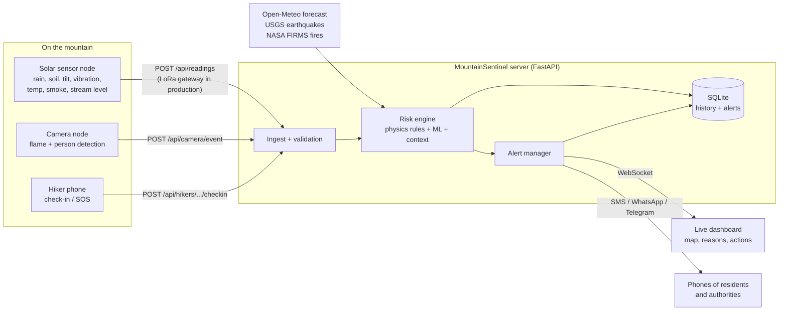

# Mountaintracker

**An AI early-warning system for mountain disasters.**
Low-cost sensor nodes, a hybrid physics + machine-learning risk engine, a laptop-camera node, and instant alerts to phones.

Built for HackDevengers 2.0 (Open Innovation, 24 hours).

> **Quick start:** double-click `run.bat` (Windows) or run `./run.sh`, then open http://localhost:8000.
> Full step-by-step guide: [docs/HOW_TO_RUN.md](docs/HOW_TO_RUN.md)

---

## The problem

Mountain regions such as the Himalayas face landslides, flash floods, forest fires and earthquakes, often together and often in places with no mobile network and no monitoring. Warnings usually arrive too late, or not at all.
Trekkers and hunters who get lost in forests are found too late because nobody knows they are missing.

## What Mountaintracker does

| Capability | How |
|---|---|
| **Landslide warning** | Rainfall against the Caine (1980) threshold, soil saturation, ground tilt and tilt speed |
| **Flash-flood warning** | Stream level, how fast it is rising, rainfall |
| **Forest-fire detection** | Smoke, heat, dryness, satellite hotspots (NASA FIRMS) and the laptop camera |
| **Ground-shaking detection** | Accelerometer. It **detects** shaking as it happens and links it to landslide risk on wet slopes. (Earthquakes cannot be predicted, and we do not claim to.) |
| **Lost-hiker alert** | Hikers check in; a missed check-in raises an alert with the last position and how dangerous the area around it is |
| **Camera node** | Any laptop webcam finds flames and people in the video and sends an alert with a photo |
| **Injured people** | The camera AI flags a person lying still on the ground and sends an alert with a photo and GPS position |
| **Lost people found by a roaming camera** | A drone, rover or phone on patrol sends its GPS position and a photo of any person it sees. Sightings close to a missing hiker's last position raise a "possible match" alert |
| **Wildlife monitoring** | The camera photographs animals, counts each species, tracks how they move (still, slow, fast, direction) and keeps a wildlife log |
| **Phone alerts** | Anyone can enter a mobile number and get SMS or WhatsApp alerts (Twilio), plus Telegram |
| **Explainable** | Every score comes with plain-language reasons and a recommended action |

## Architecture



More detail: [docs/ARCHITECTURE.md](docs/ARCHITECTURE.md)

## How the risk score works

For every reading and every hazard the engine outputs a score from 0 to 100 and a level: **Normal, Watch, Warning, Critical**.

```
score = 0.55 x physics rule score  +  0.45 x ML probability  +  live context boosts
        (never lower than a rule "override floor", such as active slope movement)
```

* **Physics rules** use published science. The landslide rule uses the global rainfall threshold of Caine (1980), `I = 14.82 x D^-0.39` (I in mm/h, D in hours), which gives about 15 mm in 1 hour and 103 mm in 24 hours. Global thresholds must be calibrated per region for real use.
* **Machine learning** (Random Forest, scikit-learn) captures interactions such as rain on already-saturated soil.
* **Live context** raises the score when the forecast shows heavy rain coming, when a NASA satellite sees a fire nearby, when a camera sees flames, or when shaking hits a wet slope (compound hazard).

### Honest note about the ML

There is no public sensor dataset of labelled events that fits this hardware, and no team can collect one in 24 hours. The models are trained on **synthetic but physically informed data** (see [ml/train.py](ml/train.py)). The reported metrics show that the models learned the hazard relationships. They are **not real-world accuracy**. The same pipeline is designed to be retrained on real history (NASA Global Landslide Catalog, IMD rain data, river gauges, FIRMS fire history) once nodes are deployed.

| Hazard | ROC-AUC (held-out synthetic) |
|---|---|
| Landslide | 0.96 |
| Flash flood | 0.91 |
| Forest fire | 0.91 |

The rule layer and the override floors are the safety net where the ML is unsure.

## What is real and what is simulated

| Real, working code | Simulated for the demo |
|---|---|
| Risk engine, ML models, API, database, WebSocket dashboard | The 6 sensor nodes (a simulator sends realistic readings) |
| Alerts, phone subscriptions, Twilio and Telegram delivery | Hikers' check-ins and the patrol drone that finds them, injured person and animal herd scenarios (each is labelled SIMULATED PHOTO) |
| Laptop camera detection running in the browser | |
| Live feeds: Open-Meteo, USGS, NASA FIRMS | |

Real hardware plugs in through `POST /api/readings`. A reference ESP32 sketch is in [firmware/](firmware/) (not tested on hardware). Hardware plan: [docs/HARDWARE_FUTURE_SCOPE.md](docs/HARDWARE_FUTURE_SCOPE.md).

## Camera detection: how it works and its limits

The camera page (`/camera.html`) runs entirely in your browser.

* **Flames:** finds bright orange to yellow pixels, then checks that the region **flickers** from frame to frame. A still orange object is ignored. Works offline.
* **People:** COCO-SSD (TensorFlow.js) detects people. Loads once from the internet.
* **Injured people:** a person whose box is wider than tall (lying down) and does not move for 5 seconds is flagged as a possible injury. It can also be a person resting, so the alert says "possible" and includes a photo for a human to check.
* **Animals:** the same AI counts bird, cat, dog, horse, sheep, cow, elephant, bear, zebra and giraffe. A tracker follows each animal to estimate how many individuals there are and how fast and in which direction they move. Species outside that list (for example deer or leopard) need a custom model.
* **Roaming:** tick "Roaming" and the camera's GPS position is attached to every event. While a person is in view, a fresh photo is sent every 10 seconds.
* Detections and a snapshot go to the server. If a sensor node is within 25 km, "camera sees flames" is added to its wildfire risk.

This is a demo-grade heuristic, not a certified fire detector. A flickering orange lamp can fool it. In production a YOLO model trained on smoke and fire images would replace it (see roadmap).

## Run it

```bash
# Windows
run.bat
# Mac / Linux
./run.sh
```

Then open:
* Dashboard: http://localhost:8000
* Camera node: http://localhost:8000/camera.html
* API docs: http://localhost:8000/docs

Deploy for a public link: [docs/DEPLOY.md](docs/DEPLOY.md).

Optional settings live in `.env` (copy `.env.example`). Everything works without any keys.

## Phone numbers

Enter your number in the dashboard, choose SMS or WhatsApp, and you receive alerts at Warning or Critical level.
Without Twilio keys the messages show in a **message log** marked "Demo, not sent". Setup: [docs/HOW_TO_RUN.md](docs/HOW_TO_RUN.md#step-8-make-phone-alerts-real-twilio-about-10-minutes).
Numbers are masked in every API response and can be removed at any time.

## API

| Method and path | Purpose |
|---|---|
| `POST /api/readings` | A sensor node sends a reading, gets the risk assessment back |
| `POST /api/camera/event` | A camera node sends what it sees |
| `POST /api/hikers/{id}/checkin` and `/sos` | Hiker position and SOS |
| `GET /api/sightings`, `GET /api/wildlife` | Photos with GPS, and species counts with movement |
| `POST /api/subscribers` | Add a phone number for alerts |
| `GET /api/state` | Everything the dashboard shows |
| `GET /api/alerts`, `/api/nodes/{id}/history`, `/api/model` | Alert log, sensor history, model metrics |
| `POST /api/demo/scenario` | Start landslide, flood, wildfire, earthquake, hiker_lost, rescue_drone, injured, animals, reset |
| `WS /ws` | Live updates |

Example: send a reading like a real device would.

```bash
curl -X POST http://localhost:8000/api/readings -H "Content-Type: application/json" -d '{
  "node_id":"my-node","node_name":"My node","lat":30.55,"lon":79.56,
  "rain_1h_mm":30,"rain_24h_mm":140,"soil_moisture_pct":92,"tilt_deg":4.2,
  "temperature_c":14,"humidity_pct":90,"smoke_ppm":8,"water_level_cm":70}'
```

## Project structure

```
MountainSentinel/
  backend/        FastAPI app: risk_engine.py, service.py, simulator.py, notifier.py, alerts.py, external_data.py
  ml/             Feature list, training script, predictor, saved models and metrics
  dashboard/      index.html (live map) and camera.html (laptop camera node)
  firmware/       Reference ESP32 sketch for a real node
  tests/          28 automated tests (pytest)
  docs/           How to run, architecture, pitch, demo script, judge Q&A, hardware plan
```

## Tests

```bash
python -m pytest
```

Covers the risk engine (calm, landslide, flood, fire, compound quake, context boosts), the API, WebSocket, camera events, and phone-number handling.

## Limitations (we are upfront about them)

* Sensor nodes and hikers are simulated in the demo. Hardware is future work.
* ML is trained on synthetic data. Real calibration needs local event history.
* The flame detector is a heuristic and can give false alarms.
* Anyone who can reach the server can subscribe a phone number. A production version needs OTP confirmation (send a code to the number first) and rate limits.
* SQLite is enough for a prototype. Production would use PostgreSQL and an MQTT/LoRaWAN ingest layer.

## Roadmap

1. Build 3 real nodes (ESP32 + LoRa) and calibrate thresholds with one district's history.
2. Replace the flame heuristic with a YOLO smoke and fire model running on an edge device.
3. LoRaWAN gateway, so nodes work with no mobile network.
4. OTP-verified sign-up, local-language voice alerts and siren integration.
5. District authority console with evacuation route suggestions.

## Team

Add your names here.

## License

MIT. See [LICENSE](LICENSE).

## Data sources and references

* Caine, N. (1980). The rainfall intensity-duration control of shallow landslides and debris flows. *Geografiska Annaler* 62A.
* Open-Meteo (weather forecast), USGS Earthquake Catalog, NASA FIRMS (active fires), OpenTopoMap (map tiles), TensorFlow.js COCO-SSD (person detection).
