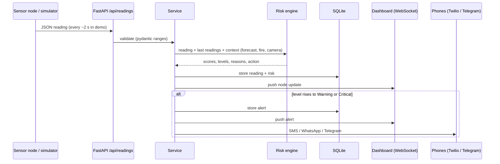

# Architecture

## Data flow

## Components

| Module | Job |
|---|---|
| `backend/risk_engine.py` | Pure function `assess()`: rules, ML blend, context boosts, override floors, reasons. Easy to test. |
| `backend/service.py` | Ingest pipeline, alert escalation logic, hikers watchdog, camera events, WebSocket hub |
| `backend/simulator.py` | Six nodes, physics-like drift towards scenario targets, simulated hikers |
| `backend/notifier.py` | Phone number validation, Twilio SMS/WhatsApp, demo-mode message log |
| `backend/alerts.py` | Alert text builders and Telegram delivery |
| `backend/external_data.py` | Open-Meteo, USGS, NASA FIRMS with caching and soft failure |
| `ml/` | Feature list, synthetic data generation, training, prediction |
| `dashboard/index.html` | Leaflet map, live panel, phone sign-up, demo controls |
| `dashboard/camera.html` | Browser camera node: flame heuristic, COCO-SSD people detection |

## Alert logic (why you will not be spammed)

* An alert fires when a hazard **escalates** to Warning or Critical. A higher level than already alerted always fires immediately.
* The same level repeats only after a cooldown (default 20 s in the demo).
* When risk returns to normal, a "back to normal" message is sent to the dashboard (not to phones).
* Phones receive Warning or Critical (each person chooses the minimum level).

## Design decisions

* **Explainability first.** Emergency workers must know why. Every score has reasons in plain language.
* **Hardware-agnostic.** Anything that can send JSON can be a node.
* **Fails soft.** No internet means no forecast, no satellite, no map tiles, but sensors, risk and alerts keep working.
* **Validated input.** Physical ranges are enforced so a broken sensor cannot corrupt the engine.
